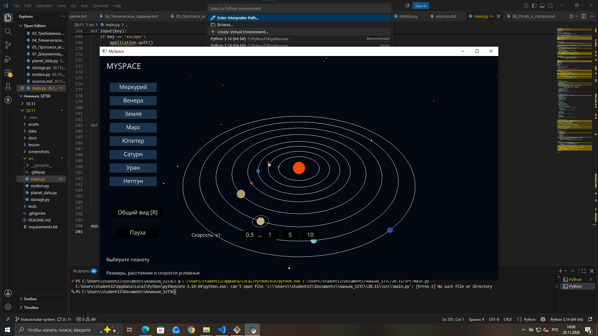
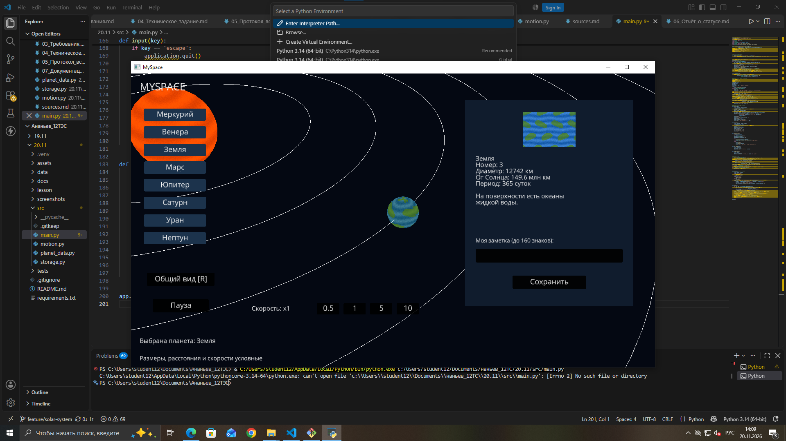
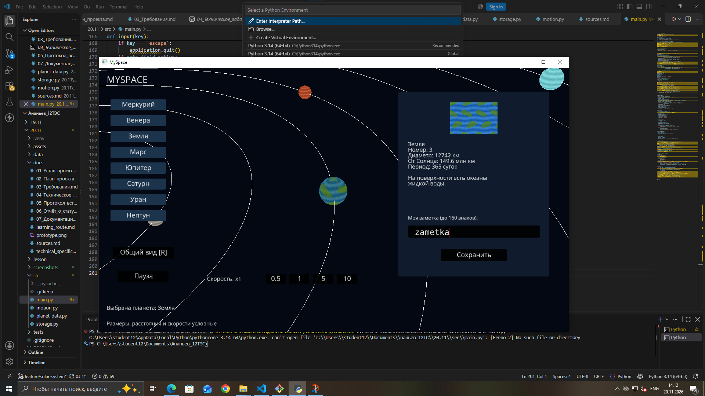

# MySpace — Интерактивный симулятор Солнечной системы

**Автор:** Ананьев Александр, группа 12 ТЭС  
**Заказчик:** Учебный центр «MySpace»  
**Версия:** 1.0  

## Назначение
Настольный интерактивный 3D-симулятор Солнечной системы с Солнцем и восемью планетами, управлением камерой, информационными карточками и сохранением пользовательских заметок в текстовый файл.

## Технологический стек
- Python 3.11–3.14
- Ursina Engine (`ursina==8.3.0`)
- Panda3D (`panda3d==1.10.16`), Pillow (`pillow==13.0.0`)
- Git

## Установка и запуск

1. Клонируйте репозиторий и перейдите в папку проекта:
   ```bash
   git clone https://github.com
   cd 20.11_MySpace
   ```

2. Создайте и активируйте виртуальное окружение:
   - **Windows (Git Bash):**
     ```bash
     python -m venv .venv
     source .venv/Scripts/activate
     ```
   - **Windows (PowerShell):**
     ```powershell
     python -m venv .venv
     .venv\Scripts\Activate.ps1
     ```
   - **Linux / macOS:**
     ```bash
     python3 -m venv .venv
     source .venv/bin/activate
     ```

3. Установите зависимости:
   ```bash
   python -m pip install -r requirements.txt
   ```

4. Запустите приложение:
   ```bash
   python src/main.py
   ```

5. Запуск модульных тестов:
   ```bash
   python -m unittest discover -s tests -v
   ```

## Управление
- **ЛКМ по планете или кнопке слева** — выбор планеты, фокусировка камеры и открытие карточки.
- **ПКМ + перемещение мыши** — поворот камеры вокруг текущей цели.
- **Колесо мыши** — приближение и отдаление.
- **Пробел / кнопка «Пауза»** — пауза и возобновление движения планет.
- **Кнопки `0.5`, `1`, `5`, `10`** — переключение скорости симуляции.
- **Клавиша `R` / кнопка «Общий вид [R]»** — возврат к общему виду системы.
- **Клавиша `Esc`** — выход из приложения.

## Скриншоты работы

| Общий вид системы | Карточка планеты | Сохранение заметки |
| :---: | :---: | :---: |
|  |  |  |

## Ограничения
- Размеры планет, радиусы орбит и скорости анимации условны; гравитационные расчёты и спутники не моделируются.
- В среде Windows ввод в поле заметки (`InputField`) с русской раскладки отображается некорректно из-за особенностей движка Ursina; для ввода заметок с клавиатуры используется латиница.
